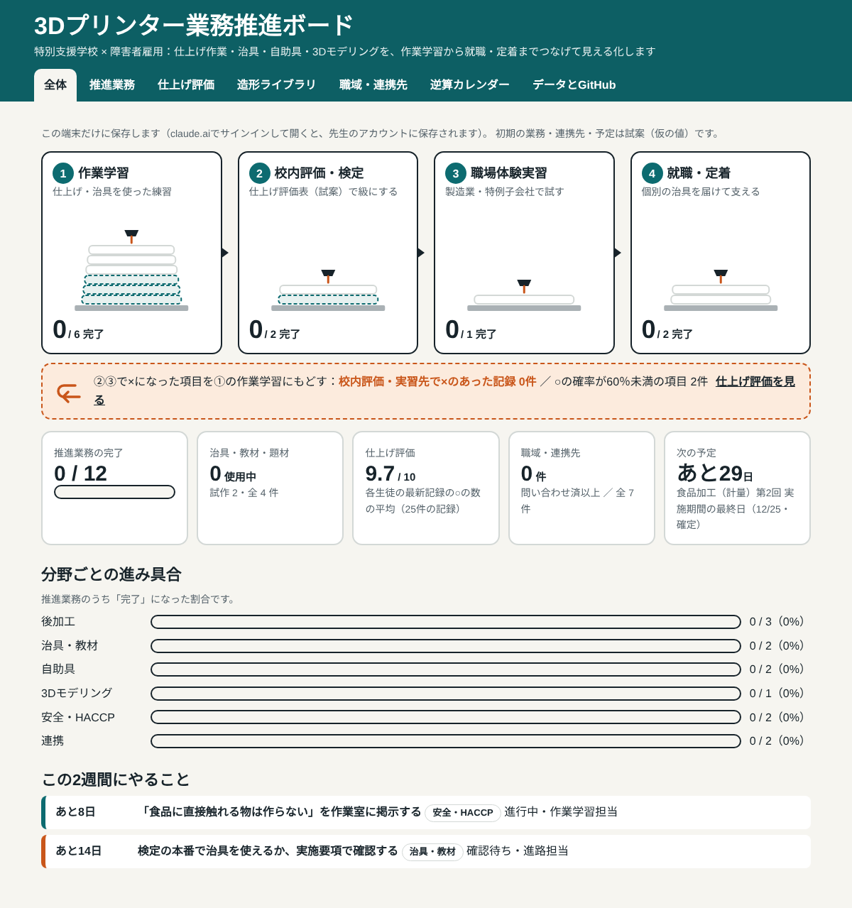

# 3Dプリンター業務推進ボード

特別支援学校の作業学習と障害者雇用で、3Dプリンター・3Dモデリングを使う業務の進み具合を見える化するダッシュボードです（試作）。
「逆算 作業学習ボード」「さぎょう きろく」と同じしくみで、1つのHTMLファイルだけで動きます。



## 画面

| タブ | 中身 |
| --- | --- |
| 全体 | ①作業学習 → ②校内評価・検定 → ③職場体験実習 → ④就職・定着 の4段階を「積層の塔」で表示。完了した業務が1層ずつ積み上がる。分野ごとの進み具合と、2週間以内にやること |
| 推進業務 | 未着手 → 進行中 → 確認待ち → 完了 のかんばん。分野（後加工・治具・教材・自助具・3Dモデリング・安全・HACCP・連携）で絞り込み |
| 仕上げ評価 | 「3Dプリント造形品 仕上げ作業〈サポート除去・研磨〉評価表（試案）」の10項目で記録。食品加工（計量）と同じルールで級を出す。項目ごとの○の確率をベイズ推定（ベータ分布）で表示 |
| 造形ライブラリ | 治具・教材・自助具・仕上げ題材の一覧。計量容器の置き位置ガイドのOpenSCADコードを数字から生成。生成AIでOpenSCADの下書き（claude.aiで開いたときだけ） |
| 職域・連携先 | 特例子会社・支援機関・研修先と、3Dとの接点（想定）・確認状況 |
| 逆算カレンダー | 予定の日から逆向きに、6週前〜1週後にやることを並べる |
| データとGitHub | 全データのJSON書き出し・読み込み |

## 使い方

- **claude.ai のアーティファクトとして開く**：記録は先生のアカウントに保存され、ほかの人には見えません。生成AIの下書きとJSONファイルの保存が使えます。
- **ローカルで開く**：`index.html` をダウンロードしてブラウザで開くだけで動きます。記録はその端末（ブラウザ）だけに保存され、生成AIは使えません。

## 拡張のしかた

| 拡張したいこと | 書きかえる場所 |
| --- | --- |
| 分野・状態・造形物の種類を増やす | `index.html` の `AREAS`・`STATUS`・`KINDS` |
| 評価表の10項目を別の作業に変える | `ITEMS` |
| 初期の業務・連携先・予定を学校用にする | `data/seed.json` を書きかえ、「データとGitHub」→「読み込んで置きかえる」 |
| 逆算の目安（6週前・2週前…）を変える | `MS` |
| 治具の生成器を増やす | `genCode()` をまねて関数を足す |

`data/seed.json` の形式：

```json
{
  "version": 1,
  "tasks":    [{"id":"t00","title":"…","area":"後加工","stage":1,"status":"未着手","due":"2027-01-29","owner":"…","note":"…"}],
  "models":   [{"id":"m00","name":"…","kind":"治具","use":"…","food":false,"mat":"PLA","min":60,"state":"設計中","who":"…","code":"// OpenSCAD"}],
  "partners": [{"id":"p00","name":"…","type":"特例子会社","area":"…","link3d":"…","status":"未確認","next":"…","src":"https://…"}],
  "events":   [{"id":"e00","name":"…","kind":"研修","date":"2027-01-13","st":"確定"}],
  "students": [{"id":"s1","code":"A-1","grade":2}],
  "evals":    [{"id":"…","sid":"s1","date":"2026-11-26","scene":"校内練習","items":["o","o","x","","o","o","o","o","o","o"],"time":"18:40","made":3,"bad":0,"note":""}]
}
```

## 注意

- 初期の業務・連携先・予定は**試案（仮の値）**です。連携先の「3Dとの接点」は想定で、各社の業務内容は確認が必要です。
- **食品に直接触れる道具は作りません。** 熱溶解積層（FDM）の造形物は、表面の積層の溝に汚れや菌が残りやすいためです。
- 生徒は記号で登録し、氏名・障害の情報は入れないでください。**このリポジトリは公開です。** 生徒の記録を書き出したJSONはコミットしないでください（`.gitignore` で `3d-print-board/data/3d-board-*.json` を除外しています）。
- ベイズ推定と級は、指導の見通しを立てるための目安です。最終の判断は先生が行います。

## テスト

`tests/test_3d_board.py` が、`data/seed.json` の形式と、`index.html` の選択肢（分野・状態など）との食い違いを確かめます。リポジトリのCI（`pytest -q`）で毎回動きます。
